<picture>
  <source media="(max-width: 600px) and (prefers-color-scheme: dark)" srcset=".github/assets/hero-mobile-dark.svg">
  <source media="(max-width: 600px)" srcset=".github/assets/hero-mobile-light.svg">
  <source media="(prefers-color-scheme: dark)" srcset=".github/assets/hero-dark.svg">
  
</picture>

Twelve repositories, all prototypes. Each README says what was verified, what was only simulated
and what has not been run at all.

<picture>
  <source media="(prefers-color-scheme: dark)" srcset=".github/assets/scene-dark.gif">
  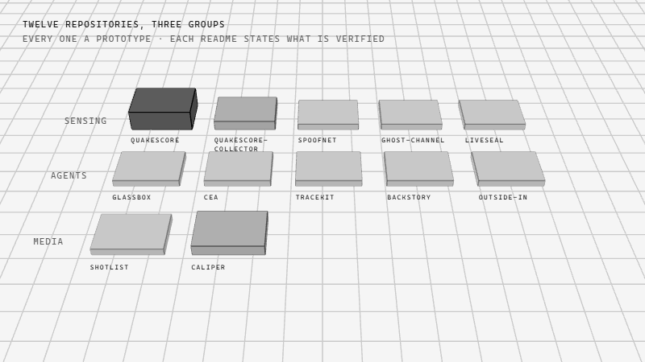
</picture>

<picture>
  <source media="(max-width: 600px) and (prefers-color-scheme: dark)" srcset=".github/assets/rule-mobile-01-dark.svg">
  <source media="(max-width: 600px)" srcset=".github/assets/rule-mobile-01-light.svg">
  <source media="(prefers-color-scheme: dark)" srcset=".github/assets/rule-01-dark.svg">
  
</picture>

Measurement from ordinary phones and screens. All validated in simulation or replay so far.

<a href="https://github.com/hesselb20-ctrl/quakescore">
<picture>
  <source media="(max-width: 600px) and (prefers-color-scheme: dark)" srcset=".github/assets/card-quakescore-mobile-dark.svg">
  <source media="(max-width: 600px)" srcset=".github/assets/card-quakescore-mobile-light.svg">
  <source media="(prefers-color-scheme: dark)" srcset=".github/assets/card-quakescore-dark.svg">
  
</picture>
</a>

<a href="https://github.com/hesselb20-ctrl/quakescore-collector">
<picture>
  <source media="(max-width: 600px) and (prefers-color-scheme: dark)" srcset=".github/assets/card-quakescore-collector-mobile-dark.svg">
  <source media="(max-width: 600px)" srcset=".github/assets/card-quakescore-collector-mobile-light.svg">
  <source media="(prefers-color-scheme: dark)" srcset=".github/assets/card-quakescore-collector-dark.svg">
  
</picture>
</a>

<a href="https://github.com/hesselb20-ctrl/spoofnet">
<picture>
  <source media="(max-width: 600px) and (prefers-color-scheme: dark)" srcset=".github/assets/card-spoofnet-mobile-dark.svg">
  <source media="(max-width: 600px)" srcset=".github/assets/card-spoofnet-mobile-light.svg">
  <source media="(prefers-color-scheme: dark)" srcset=".github/assets/card-spoofnet-dark.svg">
  
</picture>
</a>

<a href="https://github.com/hesselb20-ctrl/ghost-channel">
<picture>
  <source media="(max-width: 600px) and (prefers-color-scheme: dark)" srcset=".github/assets/card-ghost-channel-mobile-dark.svg">
  <source media="(max-width: 600px)" srcset=".github/assets/card-ghost-channel-mobile-light.svg">
  <source media="(prefers-color-scheme: dark)" srcset=".github/assets/card-ghost-channel-dark.svg">
  
</picture>
</a>

<a href="https://github.com/hesselb20-ctrl/liveseal">
<picture>
  <source media="(max-width: 600px) and (prefers-color-scheme: dark)" srcset=".github/assets/card-liveseal-mobile-dark.svg">
  <source media="(max-width: 600px)" srcset=".github/assets/card-liveseal-mobile-light.svg">
  <source media="(prefers-color-scheme: dark)" srcset=".github/assets/card-liveseal-dark.svg">
  
</picture>
</a>

<picture>
  <source media="(max-width: 600px) and (prefers-color-scheme: dark)" srcset=".github/assets/rule-mobile-02-dark.svg">
  <source media="(max-width: 600px)" srcset=".github/assets/rule-mobile-02-light.svg">
  <source media="(prefers-color-scheme: dark)" srcset=".github/assets/rule-02-dark.svg">
  
</picture>

Tools that make coding and research agents show their evidence.

<a href="https://github.com/hesselb20-ctrl/glassbox">
<picture>
  <source media="(max-width: 600px) and (prefers-color-scheme: dark)" srcset=".github/assets/card-glassbox-mobile-dark.svg">
  <source media="(max-width: 600px)" srcset=".github/assets/card-glassbox-mobile-light.svg">
  <source media="(prefers-color-scheme: dark)" srcset=".github/assets/card-glassbox-dark.svg">
  
</picture>
</a>

<a href="https://github.com/hesselb20-ctrl/cea">
<picture>
  <source media="(max-width: 600px) and (prefers-color-scheme: dark)" srcset=".github/assets/card-cea-mobile-dark.svg">
  <source media="(max-width: 600px)" srcset=".github/assets/card-cea-mobile-light.svg">
  <source media="(prefers-color-scheme: dark)" srcset=".github/assets/card-cea-dark.svg">
  
</picture>
</a>

<a href="https://github.com/hesselb20-ctrl/tracekit">
<picture>
  <source media="(max-width: 600px) and (prefers-color-scheme: dark)" srcset=".github/assets/card-tracekit-mobile-dark.svg">
  <source media="(max-width: 600px)" srcset=".github/assets/card-tracekit-mobile-light.svg">
  <source media="(prefers-color-scheme: dark)" srcset=".github/assets/card-tracekit-dark.svg">
  
</picture>
</a>

<a href="https://github.com/hesselb20-ctrl/backstory">
<picture>
  <source media="(max-width: 600px) and (prefers-color-scheme: dark)" srcset=".github/assets/card-backstory-mobile-dark.svg">
  <source media="(max-width: 600px)" srcset=".github/assets/card-backstory-mobile-light.svg">
  <source media="(prefers-color-scheme: dark)" srcset=".github/assets/card-backstory-dark.svg">
  
</picture>
</a>

<a href="https://github.com/hesselb20-ctrl/outside-in">
<picture>
  <source media="(max-width: 600px) and (prefers-color-scheme: dark)" srcset=".github/assets/card-outside-in-mobile-dark.svg">
  <source media="(max-width: 600px)" srcset=".github/assets/card-outside-in-mobile-light.svg">
  <source media="(prefers-color-scheme: dark)" srcset=".github/assets/card-outside-in-dark.svg">
  
</picture>
</a>

<picture>
  <source media="(max-width: 600px) and (prefers-color-scheme: dark)" srcset=".github/assets/rule-mobile-03-dark.svg">
  <source media="(max-width: 600px)" srcset=".github/assets/rule-mobile-03-light.svg">
  <source media="(prefers-color-scheme: dark)" srcset=".github/assets/rule-03-dark.svg">
  
</picture>

Turning footage and photos into editable structure.

<a href="https://github.com/hesselb20-ctrl/shotlist">
<picture>
  <source media="(max-width: 600px) and (prefers-color-scheme: dark)" srcset=".github/assets/card-shotlist-mobile-dark.svg">
  <source media="(max-width: 600px)" srcset=".github/assets/card-shotlist-mobile-light.svg">
  <source media="(prefers-color-scheme: dark)" srcset=".github/assets/card-shotlist-dark.svg">
  
</picture>
</a>

<a href="https://github.com/hesselb20-ctrl/caliper">
<picture>
  <source media="(max-width: 600px) and (prefers-color-scheme: dark)" srcset=".github/assets/card-caliper-mobile-dark.svg">
  <source media="(max-width: 600px)" srcset=".github/assets/card-caliper-mobile-light.svg">
  <source media="(prefers-color-scheme: dark)" srcset=".github/assets/card-caliper-dark.svg">
  
</picture>
</a>

<picture>
  <source media="(max-width: 600px) and (prefers-color-scheme: dark)" srcset=".github/assets/rule-mobile-04-dark.svg">
  <source media="(max-width: 600px)" srcset=".github/assets/rule-mobile-04-light.svg">
  <source media="(prefers-color-scheme: dark)" srcset=".github/assets/rule-04-dark.svg">
  
</picture>

Every repository follows the same layout and the same rules.

- **Structure.** What it is, why it exists, how it works, capabilities, quick start, stack and status, license.
- **Claims.** Each one traces to code, tests or a recorded result in the repository. No benchmarks without a source.
- **Status.** Stated in the header of every README. Simulated, synthetic and replayed results are labelled as such.
- **Quick start.** Only commands that were run, with the result that was seen.
- **Visuals.** Monochrome. Animated SVG and one 3D loop per repository, drawn from that repository's own data.

The design system and scene sources are in [`design/`](design).
