# Hessel

Twelve prototypes in sensing, signals and agent tooling. Each README opens with a figure built from that project's own results, and says what is verified, what is simulated and what has not been run.

## Sensing and signals

<table>
<tr>
<td width="50%" valign="top"><a href="https://github.com/hesselb20-ctrl/quakescore">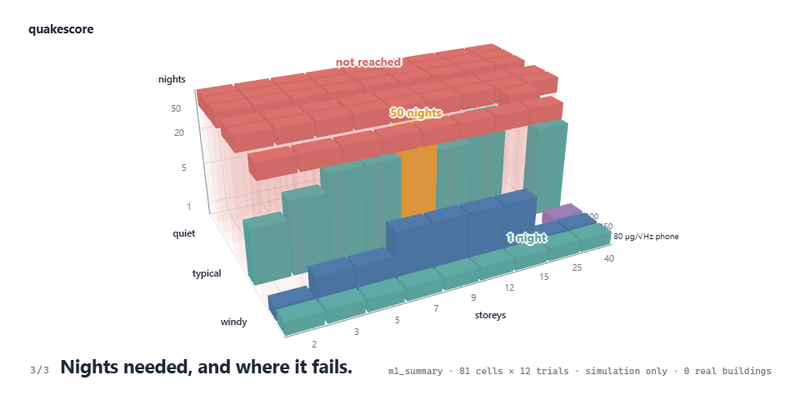</a> <b><a href="https://github.com/hesselb20-ctrl/quakescore">QuakeScore</a></b> Seismic vulnerability screening from phones at rest. Research prototype · simulation only</td>
<td width="50%" valign="top"><a href="https://github.com/hesselb20-ctrl/quakescore-collector">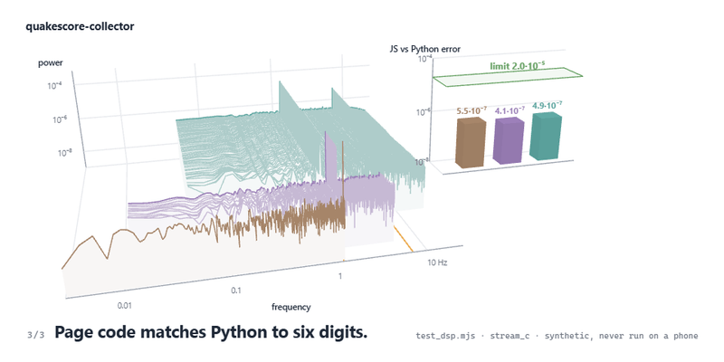</a> <b><a href="https://github.com/hesselb20-ctrl/quakescore-collector">QuakeScore Collector</a></b> Measures building vibration in a phone's browser. Prototype · simulated input only</td>
</tr>
<tr>
<td width="50%" valign="top"><a href="https://github.com/hesselb20-ctrl/spoofnet">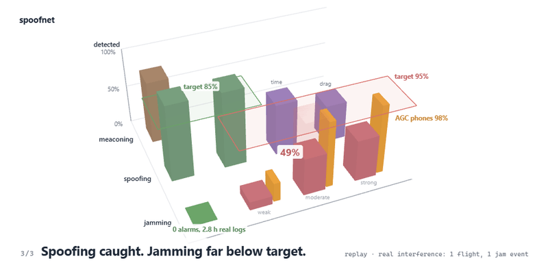</a> <b><a href="https://github.com/hesselb20-ctrl/spoofnet">SpoofNet</a></b> GNSS jamming and spoofing, mapped from phones. Research prototype · replay-tested</td>
<td width="50%" valign="top"><a href="https://github.com/hesselb20-ctrl/ghost-channel">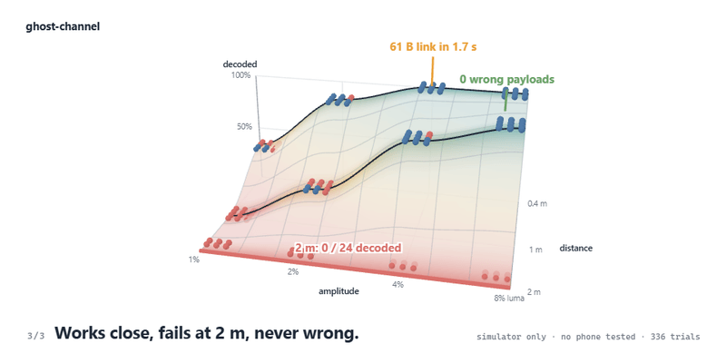</a> <b><a href="https://github.com/hesselb20-ctrl/ghost-channel">Ghost Channel</a></b> Sends data to a camera as faint screen flicker. Prototype · no phone tested yet</td>
</tr>
<tr>
<td width="50%" valign="top"><a href="https://github.com/hesselb20-ctrl/liveseal">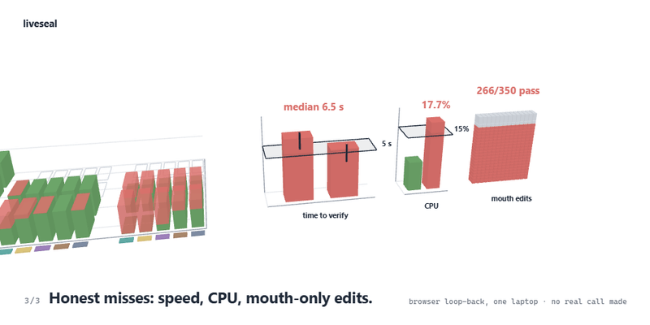</a> <b><a href="https://github.com/hesselb20-ctrl/liveseal">LiveSeal</a></b> A signed seal in live video, checked by the receiver. Research preview · no real call yet</td>
<td width="50%"></td>
</tr>
</table>

## Agent tooling

<table>
<tr>
<td width="50%" valign="top"><a href="https://github.com/hesselb20-ctrl/glassbox">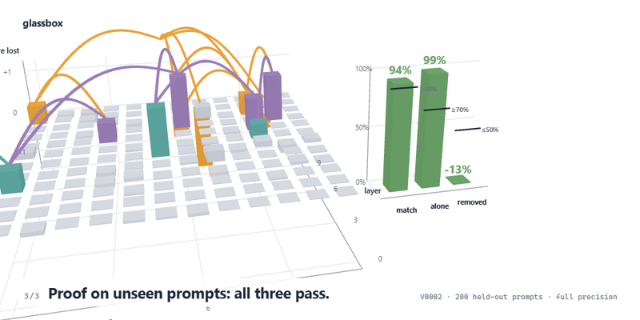</a> <b><a href="https://github.com/hesselb20-ctrl/glassbox">Glassbox</a></b> An interpretability lab Claude Code drives over MCP. Research prototype · v0.1.0</td>
<td width="50%" valign="top"><a href="https://github.com/hesselb20-ctrl/cea">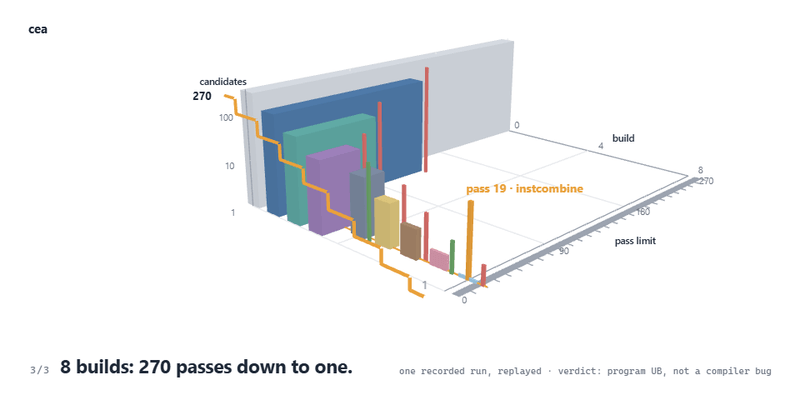</a> <b><a href="https://github.com/hesselb20-ctrl/cea">cea</a></b> Makes coding agents prove compiler claims. Prototype v0.1.0 · partly verified</td>
</tr>
<tr>
<td width="50%" valign="top"><a href="https://github.com/hesselb20-ctrl/tracekit">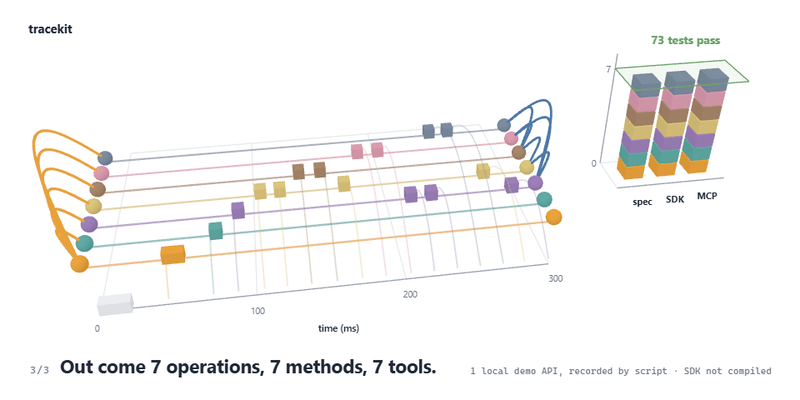</a> <b><a href="https://github.com/hesselb20-ctrl/tracekit">tracekit</a></b> HAR recording in. OpenAPI spec, SDK and MCP server out. Prototype · one local demo API</td>
<td width="50%" valign="top"><a href="https://github.com/hesselb20-ctrl/backstory">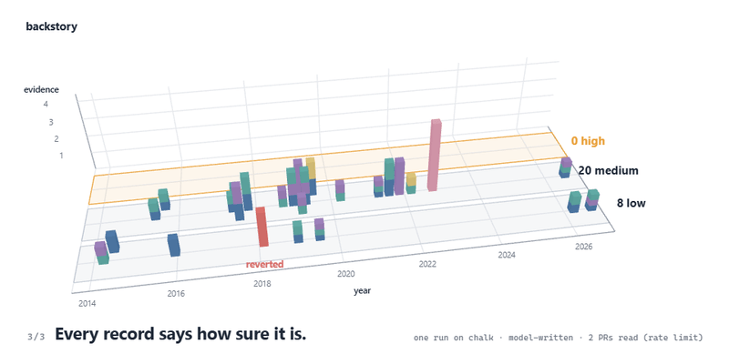</a> <b><a href="https://github.com/hesselb20-ctrl/backstory">Backstory</a></b> Rebuilds the decisions behind code from its git history. Prototype · v0.1.0 · not on npm</td>
</tr>
<tr>
<td width="50%" valign="top"><a href="https://github.com/hesselb20-ctrl/outside-in">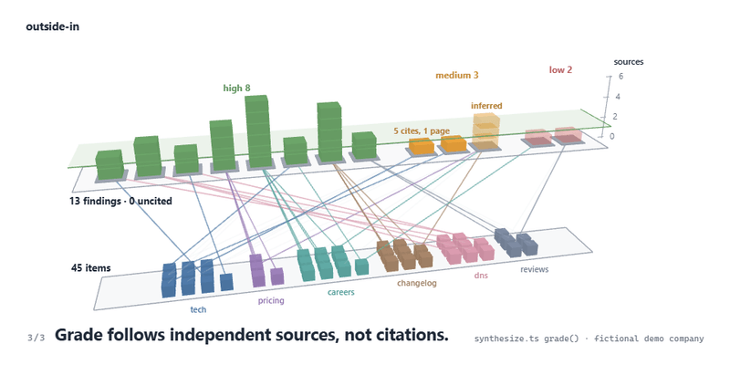</a> <b><a href="https://github.com/hesselb20-ctrl/outside-in">Outside-In</a></b> Evidence-backed company profiles from public signals. Prototype · v0.1.0 · not on npm</td>
<td width="50%"></td>
</tr>
</table>

## Media and CAD

<table>
<tr>
<td width="50%" valign="top"><a href="https://github.com/hesselb20-ctrl/shotlist">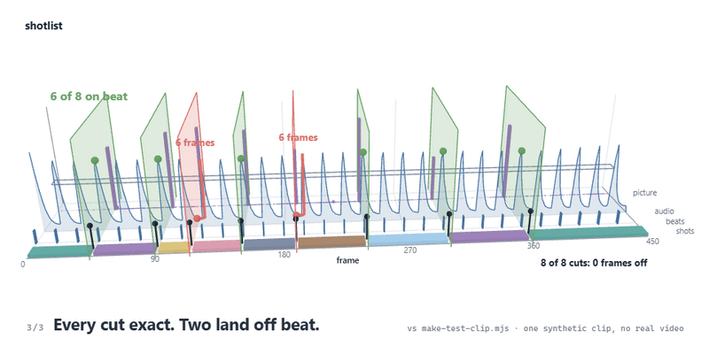</a> <b><a href="https://github.com/hesselb20-ctrl/shotlist">shotlist</a></b> Shot list and Remotion template from a short video. Prototype · tested on one synthetic clip</td>
<td width="50%" valign="top"><a href="https://github.com/hesselb20-ctrl/caliper">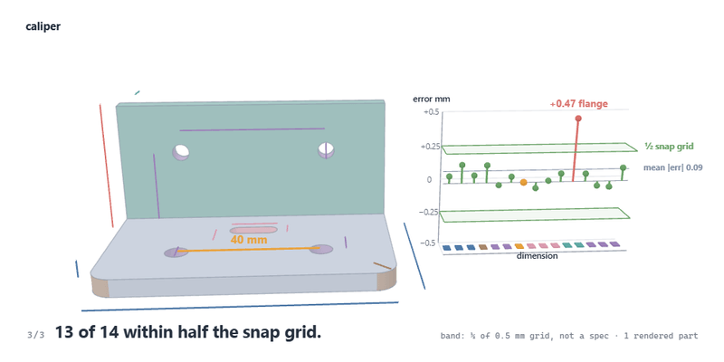</a> <b><a href="https://github.com/hesselb20-ctrl/caliper">Caliper</a></b> Parametric CAD from photos and one measurement. Prototype · synthetic test only</td>
</tr>
</table>

The sources for the figures (Remotion and React Three Fiber scenes and the shared chart kit) are in [`design/`](design).
